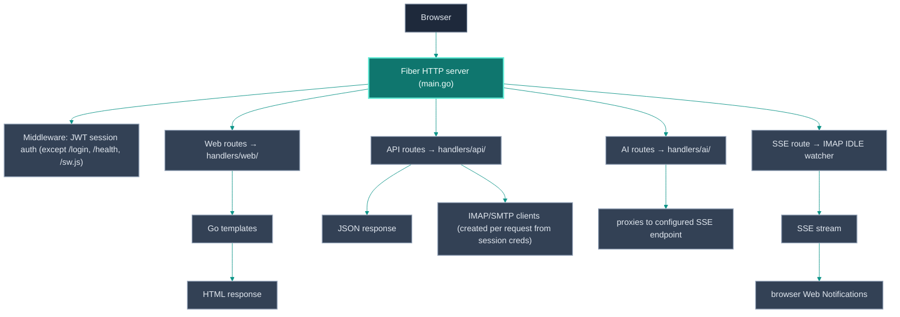

# Architecture

lilmail is a server-rendered Go web application using the
[Fiber](https://gofiber.io/) HTTP framework. All frontend assets and HTML
templates are embedded in the binary at build time via `embed.FS` — no static
file server or separate asset pipeline is required.

## Repository layout

```text
lilmail/
├── main.go                  # Entry point: config, DI wiring, route registration
├── config/
│   ├── config.go            # Config structs + TOML loader
│   └── config_test.go
├── handlers/
│   ├── ai/                  # AI mail assistant endpoints
│   ├── api/                 # Mail ENGINE: IMAP/SMTP client, MIME, threading, CalDAV
│   ├── jsonapi/             # /v1 JSON REST API over the engine (for external UIs)
│   └── web/                 # HTML page handlers (inbox, viewer, settings, …) — HTMX
├── models/
│   ├── email.go             # Email, Attachment, Thread, Invite model types
│   ├── calendar.go          # CalDAV event types
│   └── contact.go           # CardDAV contact types
├── storage/
│   ├── session.go           # File-backed fiber session store (one JSON file per key)
│   ├── kv.go                # Durable KV seam + backend selector (Open)
│   ├── bolt.go              # Embedded bbolt backend (default)
│   ├── postgres.go          # Optional shared Postgres backend (opt-in)
│   └── object.go            # Optional shared-object (S3) seam — attachment cache only
├── sessions/                # Runtime session state (file-based)
├── utils/
│   └── cache.go             # On-disk cache helpers
├── templates/               # Go HTML templates
│   ├── layouts/main.html    # Shared app shell (nav, sidebar, top bar)
│   ├── partials/            # HTMX partial fragments (email-list, compose, …)
│   ├── inbox.html
│   ├── login.html
│   ├── settings.html
│   ├── calendar.html
│   └── calendar-week.html
├── assets/
│   ├── css/mail.css         # Hand-written CSS (dark mode, responsive)
│   ├── vendor/              # htmx.min.js, alpine.min.js (+ their .LICENSE files)
│   └── sw.js                # Service worker (Web Push)
├── scripts/                 # Developer tooling (Playwright screenshotter, demo seed)
├── docs/                    # Documentation and screenshots
├── site/                    # The published site — landing, docs viewer, and
│   ├── gen/                 #   site/gen: Go generator + the tests that gate it
│   ├── assets/vendor/       #   vendored marked/highlight.js — no CDN at runtime
│   └── screenshots/         #   captures mirrored from docs/screenshots/
├── brand/                   # Logo source
├── types/                   # TypeScript declarations for the service worker
├── .github/workflows/       # CI + release pipelines
├── config.toml.example
├── go.mod / go.sum
└── tmpl_smoke_test.go       # Template parse smoke test
```

## Request lifecycle



## Key subsystems

### Authentication

`handlers/web/auth.go` (and `handlers/web/oauth.go`) handle login/logout.
Credentials are encrypted with AES-GCM (`[encryption].key`; AES-128/192/256
chosen by the key's 16/24/32-byte length) before being
stored in the JWT session. The JWT is signed with `[jwt].secret` and stored in
a `SameSite=Lax` HTTP-only cookie (`Secure` when `[server].secure_cookies =
true`).

OAuth2: lilmail runs the full authorization-code flow with PKCE. After callback,
the access + refresh tokens are encrypted and stored in the session exactly like
passwords. Token refresh happens transparently on the next IMAP/SMTP operation
that receives a 401/NO AUTHENTICATE.

### IMAP / SMTP

`handlers/api/email.go` creates IMAP clients from session credentials on each
request using `emersion/go-imap`. There is no persistent connection pool —
connections are opened, used, and closed per request. This keeps memory usage
low and makes the server stateless with respect to IMAP state. (A pool was
considered and not built: an IMAP connection has one selected mailbox, so it
would have to be handed to one request at a time, health-checked, keyed by the
verified session identity, and closed on logout — state and a cross-user leak
risk for a gain that depends on the server's login cost. Set `LILMAIL_TIMING=1`
to measure that cost first.)

Connections carry deadlines: 10 s to connect and receive the greeting
(`dialIMAP`, `imapDialTimeout`) and 60 s per command (`imapCmdTimeout`). go-imap
applies `Client.Timeout` to every command, which would kill IDLE, so
`WatchInbox` resets it to 0. IMAP open errors are classified as `api.ErrConnect`
(unreachable, TLS mismatch, timeout) or `api.ErrLogin` (credentials rejected) so
the login page can tell them apart.

Message lists are paged by IMAP sequence number: `FetchMessagesPagedTotal` takes
the folder size from the `SELECT` response and fetches the window ending
`offset` from the newest; the web layer asks for one extra message to learn
whether a next page exists. Search returns UIDs only, so a search page costs one
`SEARCH` plus a `FETCH` of that page (`SearchMessagesPaged`, `searchWindow`).
Free text maps to `OR HEADER SUBJECT … HEADER FROM …` (or the fields chosen in the
UI, `NormalizeSearchMods`); `body:` / `text:` opt into a body scan.

SMTP connections are opened by one `SMTPClient.dial()` (implicit TLS, or plain
TCP + `EHLO` + `STARTTLS`) with a 10 s connect/greeting limit and a 2-minute
session limit. For additional accounts `smtpModeForAccount`
(`handlers/web/auth.go`) picks the transport per account — see
[Per-account TLS](CONFIGURATION.md#per-account-tls).

SMTP sending lives in `handlers/api/stmpClient.go`, with the outgoing MIME
assembled by `handlers/api/mime_builder.go` (multipart/mixed + multipart/related
`cid:` inline images, with every structured header value screened against CR/LF/
NUL injection). The SASL mechanism (plain, XOAUTH2, or OAUTHBEARER) is chosen
based on `[oauth2].mechanism`.

### Caching

Fetched email metadata is written to the on-disk cache (`[cache].folder`) as
JSON files, one per folder. MIME bodies are cached separately. Cache keys are
based on the sanitized username and folder name (path-traversal-safe).

The sidebar's `folders.json` is written at login; if it is missing or unreadable
(cache directory cleared, a session that outlived it) `loadFolders` rebuilds it
from IMAP instead of failing the page.

### Conversation threading

Thread graphs are built using the JWZ algorithm over `Message-ID`, `References`
and `In-Reply-To` headers (`handlers/api/threading.go`).

The web message list threads **the page being shown only** (`api.ThreadMessages`
on that page's messages; the unified inbox threads each account separately, since
UIDs and Message-IDs are per mailbox and subject grouping must not fuse unrelated
mail from two accounts). The bbolt header cache in
`handlers/api/threadstore.go` is not used for lists: it unions every header ever
cached for a folder, which repeated earlier pages' messages once the list became
paged and hid replies that threaded into a row rendered before they were fetched.
Page-local threading is deterministic — every message appears exactly once — at
the cost that a conversation straddling a page boundary shows as two rows.
(`threadstore.go` still backs the Drafts list, and opens its own database file
directly.)

(`storage/session.go` is unrelated to threading despite the neighbouring name:
it is `FileStorage`, the fiber session store, and it writes one JSON file per
session key under `./sessions`. No bbolt is involved.)

### Durable storage seam

`storage/` defines a small backend-agnostic `KV` interface (`kv.go`) with two
implementations: `bolt.go` (embedded bbolt, the default — keeps lilmail a single
binary with nothing to run) and `postgres.go` (an optional shared SQL store,
opt-in via `[storage] backend = "postgres"`). `storage.Open(cfg, boltPath)`
selects the backend so callers never branch on it. Postgres is reusable by other
Vulos services that need to read the same store; it is never the default. See
[CONFIGURATION.md](CONFIGURATION.md#storage).

### Shared object storage (supplementary only)

lilmail's primary stores are **IMAP** (the mail itself — the durable source of
truth), the **KV seam** above (scheduled send, settings, connected accounts) and
a handful of bbolt files opened directly rather than through the seam (thread
graphs, recipient history, push subscriptions — so `backend = "postgres"` does
**not** move those three). Neither needs object storage, so lilmail's
participation in the Vulos unified object
store is deliberately **light and supplementary**.

`storage/object.go` adds an optional S3 `ObjectStore` seam that is used for one
thing only: a **read-through cache of immutable attachment blobs**, so repeated
downloads of the same MIME part don't re-pull it from IMAP. It activates **only**
when the Vulos OS gateway injects `X-Vulos-Storage-*` headers on a request *and*
the request is **authenticated as coming from the gateway**: the operator must
set `VULOS_STORAGE_BROKER_SECRET` and the request must present a matching
`X-Vulos-Storage-Broker-Auth` header (constant-time compared via
`crypto/subtle`). This is the **same auth gate** the mail credential-injection seam uses (`LILMAIL_BROKER_SECRET` + `X-Vulos-Broker-Auth`), not a bare on/off
toggle — the secret being set is the enable signal. Absent the secret, or with an
absent/mismatched auth header, the storage headers are ignored entirely and the
attachment route behaves exactly as before (fetch from IMAP every time). See
[CONFIGURATION.md](CONFIGURATION.md#storage).

As a second SSRF/exfiltration guard, the injected endpoint must use `https://`
unless it names a loopback or private-network host (sidecar MinIO, RFC 1918
address, `*.internal`/`*.local`); a plaintext endpoint to a public host is
refused.

Properties: objects live under the gateway-provided prefix (`<userID>/<appID>/`)
in a `mail/` sub-space (`<prefix>/mail/attachments/<id>`); the cache is pure
read-through (IMAP stays authoritative; a cache miss or any S3 error falls back to
IMAP and is never surfaced to the user); the client is a minimal self-contained
AWS SigV4 GET/PUT (no new dependency, single binary preserved). The seam is **off
by default** so standalone lilmail never trusts injected storage headers — the
same fail-closed posture as the mail credential-injection seam.

### JSON API (`handlers/jsonapi`)

A clean `/v1` JSON/REST surface served alongside the HTMX UI. It reuses the same
mail engine (`handlers/api`) and the same session auth path
(`web.AuthHandler.CreateIMAPClient`), so there is no duplicated mail logic and
the HTMX UI is untouched. Unlike the HTMX `SessionMiddleware` (which redirects to
`/login`), the API returns `401` JSON. This is the stable contract the Vulos OS
builds its mail, Calendar, and Contacts surfaces on. See [API.md](API.md).

Two subsystems live inside this package:

- **Injected-credential mode** (`broker.go`): a first middleware validates
  `X-Vulos-Broker-Auth` against `LILMAIL_BROKER_SECRET` (constant-time) and, when
  it matches, parses the `X-Vulos-Mail-*` headers into a per-request connection
  spec so lilmail builds the IMAP/SMTP/DAV client directly from them instead of a
  session. It only ever describes the user's own account; lilmail hosts no mail and
  depends on no central server. Fail-closed: an unset/mismatched secret makes the
  headers ignored entirely, so standalone lilmail never trusts client-supplied
  connection headers. Calendar/contacts ride the same gate via their own per-account
  URL headers (`X-Vulos-Mail-Caldav-Url` / `-Carddav-Url`).
- **Scheduled send** (`schedule.go` / `schedule_store.go`): `POST /v1/messages`
  with a future `sendAt` persists the compose payload (SMTP transport captured and
  encrypted at rest in the KV seam) and a single poll-based drain goroutine
  delivers it at the due time, rebuilding the MIME through the same
  `BuildMIMEMessage` engine. At-least-once, with a boot catch-up pass and a
  bounded retry budget. Enabled only when a KV store is wired (`NewWithStore`);
  otherwise the `/v1/scheduled` surface reports `501`.

### Notifications

When `[notifications].enabled = true`, a per-session IMAP IDLE goroutine is
started after login. New-mail events are pushed to a channel that drives an SSE
response on `GET /events`. The watcher's IMAP client is created inside the
`/events` request (`NotificationHub.Subscribe`): Fiber recycles its request
context as soon as a handler returns, so the goroutine must never touch it.
`WatchInbox` runs IDLE until the server announces more messages, ends IDLE,
fetches the new envelopes, and resumes — a `FETCH` cannot run while IDLE holds
the connection. The browser Web Notifications API is triggered from
client-side JavaScript listening to the SSE stream.

Web Push uses the `SherClockHolmes/webpush-go` library. VAPID keys are
auto-generated on first start and persisted to `vapid.json`.

### CalDAV / CardDAV

`handlers/web/calendar.go` uses `emersion/go-webdav` + `emersion/go-ical` for
CalDAV and `emersion/go-vcard` for CardDAV. Both are purely opt-in: routes and
goroutines are only registered when the respective config section has
`enabled = true`.

### AI assistant

`handlers/ai/` proxies requests to a configurable OpenAI-compatible
chat-completion endpoint. Prompts live in `handlers/ai/prompts/*.txt` and are
loaded at startup. No mail content is persisted by lilmail; it is forwarded and
discarded.

### Frontend

The UI is server-rendered Go templates enhanced with
[HTMX](https://htmx.org/) (partial page updates) and
[Alpine.js](https://alpinejs.dev/) (inline interactivity). All vendor JS is
checked in under `assets/vendor/` — there is no npm or build step. CSS is
hand-written in `assets/css/mail.css` (~77 KB) with a dark-mode theme.

**List rows.** The rows of the message list are one template, `email-rows`
(`templates/inbox.html`), rendered inline by the inbox page and by
`partials/email-list.html` for every HTMX swap, search and next page. A row
carries `data-id`, `data-folder` and (unified view) `data-account`, and its
`@click` is a fixed string that calls `openMessage()` (`assets/js/app.js`). No
mailbox value is spliced into inline JavaScript and no token is embedded per row;
the bearer token and CSRF token are added to htmx requests by the
`htmx:configRequest` handler. The next page is a sentinel element with
`hx-trigger="intersect once"` — htmx 1.9's `revealed` only listens to `window`
scroll, not to a scrolling container.

**Message bodies.** HTML mail renders in an `<iframe sandbox>` (no
`allow-scripts`). Remote content is neutralised server-side and the document
carries its own `Content-Security-Policy` (`data:` images only until the user
opts in). "Display images" cannot just change the `srcdoc` frame — a `srcdoc`
document inherits the app's CSP (`img-src 'self' data: blob:`) and the browser
would refuse every remote resource — so it points the frame at
`GET /api/email/:id/body?images=1`, which returns the body as a real document
with its own CSP header and `Referrer-Policy: no-referrer`.

**Static assets.** The `asset` template function (`assetver.go`) appends
`?v=<sha256 prefix of the embedded file>` to css/js URLs. Versioned URLs are served
`Cache-Control: public, max-age=31536000, immutable`; unversioned ones (icons,
manifest) for an hour. `css/js/svg/manifest` are compressed; **dynamic HTML is not**
— those pages hold the bearer token and mailbox content next to attacker-influenced
text, the precondition for a BREACH-style compression side channel. Shrinking the
HTML is done by sending less of it, not by compressing it.

## Build and embedding

`go build ./...` produces a single self-contained binary. `//go:embed` directives
in `main.go` embed `templates/`, `assets/`, and `handlers/ai/prompts/` into the
binary at compile time. The binary can run fully air-gapped without any companion
files except `config.toml`.

## CI / release

`.github/workflows/ci.yml` — runs `go build`, `go vet`, and `go test ./...` on
every push.

`.github/workflows/release.yml` — triggered on `v*` tags; cross-compiles for
Linux and macOS (`amd64` and `arm64`), packages the archives alongside a source
zip and a `SHA256SUMS` manifest covering every asset, and publishes them to the
[latest release](https://github.com/vul-os/lilmail/releases/latest).
